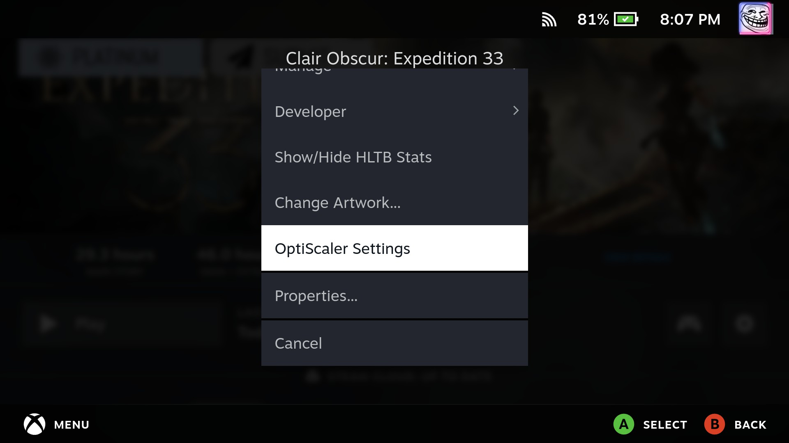
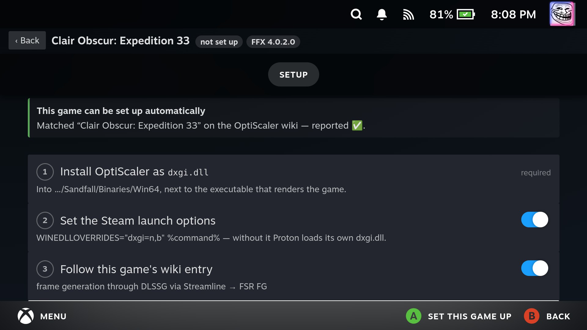

# Decky Upscaler Manager

[](https://github.com/supercleans/decky-upscaler-manager/actions/workflows/release.yml)
[](https://github.com/supercleans/decky-upscaler-manager/releases/latest)

게임 모드(SteamOS, Bazzite 등)에서 게임별로 업스케일러를 골라 설치하고 관리하는
[Decky Loader](https://github.com/SteamDeckHomebrew/decky-loader) 플러그인입니다.
[OptiScaler](https://github.com/optiscaler/OptiScaler)의 **FSR 4 Lite**, cyboman의 FSR 4.1.2 Lite 빌드,
[HelixSR](https://github.com/lonewolf0622/HelixSR)의 HLX FSR 4와 HLX DLSS 중에서 고르면 게임에 맞는
방식(드롭인, OptiScaler, HelixSR Scaler)으로 넣고, 그 밖의 설정은 OptiScaler의 게임 내 오버레이에서
바꿉니다. 예전 이름은 Decky OptiScaler Plus입니다.

OptiScaler는 [nightly 채널](https://github.com/optiscaler/OptiScaler-nightly/releases)에서 받아옵니다.
플러그인의 처음 설치 때 최신 빌드(v10)를 내려받아 릴리스에 적힌 해시로 검증하고, 모든 게임이 그
사본을 함께 씁니다.

> **비공식 플러그인입니다.** 저는 OptiScaler, HelixSR, cyboman의 빌드, AMD, NVIDIA와 관계없는 개인
> 개발자입니다. 이 플러그인은 그들이 만들거나 보증하거나 지원하지 않으며, 그들이 공개한 릴리스를 받아
> 스팀덱 UI에서 다룰 수 있게 해 줄 뿐입니다. 플러그인 관련 문제는 그 프로젝트들의 관리자에게 말고
> [여기](https://github.com/supercleans/decky-upscaler-manager/issues)에 알려 주세요.

## 기능

- **게임과 설치할 폴더를 찾습니다.** SD 카드를 포함해 `libraryfolders.vdf`에 있는 Steam 라이브러리,
  Steam 외 바로가기, 직접 추가한 사용자 지정 라이브러리 폴더를 모두 읽습니다. OptiScaler는 D3D
  디바이스를 만드는 실행 파일 옆에 있어야 하므로, 후보 폴더(Unreal의 `Binaries/Win64`, 사이버펑크의
  `bin/x64` 등)에 점수를 매겨 고르고, 필요하면 직접 바꿀 수 있습니다.
- **시도해 볼 만한 게임을 알려 줍니다.** 목록의 모든 게임에 배지가 붙습니다. 게임에 들어 있는
  DLSS·XeSS·FSR 라이브러리, 64비트 Windows 실행 파일 여부, 안티치트, 그리고 호환성 목록을 보고
  판정하며, **호환** 탭에서 가능성 있는 게임만 모아 볼 수 있습니다. 배지는 참고용입니다. FSR을 실행
  파일에 직접 넣은 게임은 배지가 없어도 동작합니다.
- **위키를 보고 게임을 설정합니다. 오프라인에서도 됩니다.** 게임을 OptiScaler
  [호환성 목록](https://github.com/optiscaler/OptiScaler/wiki/Compatibility-List)과 맞춰 보고, 검색창에서
  올바른 항목을 직접 지정할 수도 있습니다. 목록 사본이 플러그인에 들어 있고 마지막으로 받은 목록은
  캐시되므로, 답은 디스크에서 바로 나오고 새로 고침은 뒤에서 진행됩니다. 설치는 체크리스트로
  진행됩니다. 항목이 지정한 파일 이름으로 DLL을 설치하고, 실행 옵션을 쓰고, 항목에 적힌 설정을
  적용합니다. 무엇을 쓰기 전에 각 줄이 위키의 어느 필드에서 왔는지 보여 줍니다. 플러그인이 해석하지
  못한 내용은 추측하지 않고 그대로 보여 주며,
  [REFramework](https://github.com/praydog/REFramework)를 먼저 설치해야 하는 게임도 알려 줍니다.
- **OptiScaler 말고 필요한 것도 알려 줍니다.** 위키에 Luma 모드, DLSS 모드, SekiroTSR 같은 모드나
  `nvngx_dlss.dll` 복사, Engine.ini 수정, 안티치트 끄기가 필요하다고 적힌 게임은 설치 탭의 **OptiScaler
  말고 필요한 것**에 항목마다 필수·권장 여부와 위키 원문, 받을 곳을 보여 줍니다. 위키의 “Luma Unreal
  Engine”, “Upscaler mods support” 표에 있는 게임도 표 단위로 인식합니다. 이 항목들은 플러그인이 설치하지
  않으며, 게임 목록에는 **모드 필요** 표시가 붙습니다.
- **설치할 때마다 스팀덱용 FSR 4 Lite를 적용합니다.** 2026-10-29 nightly부터는 nightly에 든 FSR
  4.1.2 업스케일러에 INT8 Lite 모델이 들어 있고, OptiScaler가 스팀덱 GPU를 알아서 INT8 Lite로
  잡습니다. 그래서 따로 넣는 파일이나 FSR 4 설정 없이, ini에는 업스케일러 백엔드(`ffx`/`ffx_12`)만
  씁니다. OptiScaler 오버레이에서 다른 값으로 저장해 프리셋이 바뀌면 설정 화면이 알려 주고 다시
  적용할 수 있습니다. 자세한 내용은 [스팀덱 FSR 4 Lite](docs/steam-deck-fsr4.md)를
  참고하세요.
- **설정 화면은 따로 없습니다. OptiScaler 오버레이에서 합니다.** 프레임 생성, 업스케일러, 샤프닝 등은
  OptiScaler 자체 오버레이(`Insert` 키, Steam Input에서 버튼에 지정)에서 바꾸며, 대부분 게임 실행 중에
  바로 바뀝니다. 오버레이의 **Save Settings**를 누르면 다음 실행에도 유지됩니다.
- **업스케일러를 먼저 고릅니다.** 게임의 설치 탭은 업스케일러 선택으로 시작합니다. 설치 방식은
  고른 업스케일러와 게임 파일에 따라 정해지고, 그 방식에 필요한 단계만 보여 줍니다.

  | 업스케일러 | 설치 방식 |
  |---|---|
  | **FSR 4 Lite** (기본) | FSR 3.1 게임은 nightly에 든 AMD FSR 4.1.2 파일을 드롭인으로(시험), 그 외는 OptiScaler nightly + FSR 4 Lite 프리셋 |
  | **FSR 4.1.2 Lite exact** | FSR 3.1 게임은 드롭인, 그 외는 OptiScaler의 FidelityFX 업스케일러 자리에 |
  | **FSR 4.1.2 Lite lossy** | FSR 3.1 게임은 드롭인, 그 외는 OptiScaler의 FidelityFX 업스케일러 자리에 |
  | **HLX FSR 4** | FSR 3.1 게임은 드롭인, 그 외는 OptiScaler의 FidelityFX 업스케일러 자리에 |
  | **HLX DLSS** | HelixSR Scaler |

  기본 추천은 기기에 따라 다릅니다. 스팀덱(LCD·OLED)은 **FSR 4 Lite**, BC-250은 **HLX FSR 4**입니다.
  BC-250에서는 **HLX FSR 4와 HLX DLSS만** 고를 수 있습니다. OptiScaler가 이 GPU를 FSR 4 지원 GPU로 보지
  않아 AMD의 FSR 4와 cyboman 빌드는 FSR 3으로 돌고, int8 연산도 느립니다. HLX FSR 4는 거기서 fp16 버전을
  골라 씁니다. 기기는 GPU의 PCI ID로 알아냅니다.

  OptiScaler(nightly)로 설치할 때는 업스케일러 FSR 4 계열을 모두 함께 넣습니다. 고른 빌드(cyboman 또는
  HLX FSR 4)는 OptiScaler 폴더의 FidelityFX 업스케일러 자리(`OptiScaler/amd_fidelityfx_upscaler_dx12.dll`)에
  들어가므로, DX12뿐 아니라 DX11·Vulkan 게임(dx11on12·VKon12의 `ffx_12`)에서도 그 빌드가 돕니다. AMD의
  FSR 4와 나머지 빌드는 `OptiScaler/custom/`에 넣어 플레이 중 오버레이에서 바꿔 가며 비교할 수 있습니다.
  FSR 4 Lite를 고르면 AMD 파일이 그 자리에 있고 cyboman exact·lossy와 HLX FSR 4가 custom에 들어갑니다.
  고른 것이 아닌 업스케일러를 받지 못하면 그것만 빼고 설치하고 알려 줍니다.

  쓸 수 없는 업스케일러는 이유를 함께 보여 주고, 이미 설치된 게임은 다른 업스케일러를 고르면 파일
  이름·설정·실행 옵션을 유지한 채 바꿀 수 있습니다.
- **cyboman의 FSR 4.1.2 Lite 빌드.**
  [fsr4-shader-performance-overrides](https://github.com/zgauthier2000/fsr4-shader-performance-overrides)의
  스팀덱용 빌드 두 가지를 씁니다. **exact**는 AMD FSR 4.1.2 Lite와 화질이 같고 조금 빠르며, **lossy**는
  재학습해서 AMD Lite보다 약 18% 빠르지만 화질이 조금 다릅니다. FSR 3.1을 자체 DirectX 12 DLL로 가진
  게임(몬스터 헌터 와일즈, 레지던트 이블 레퀴엠 등)은 그 파일만 바꾸는 **드롭인**으로 넣어
  OptiScaler와 REFramework가 필요 없습니다. 그 외 게임은 OptiScaler의 FidelityFX 업스케일러 자리에 넣어
  DX12·DX11·Vulkan 게임 모두에서 쓰고, AMD의 FSR 4.1.2는 custom 업스케일러로 옮겨 오버레이에서 나란히
  고를 수 있게 합니다. 원본은 백업되며, 게임 목록에서
  드롭인이 가능한 게임과 OptiScaler + REFramework로만 가능한 게임을 구분해 표시합니다.
- **HelixSR의 HLX FSR 4와 HLX DLSS.** [HelixSR](https://github.com/lonewolf0622/HelixSR)는 AMD FSR 4
  신경망과 NVIDIA DLSS 신경망을 일반 컴퓨트 셰이더로 돌립니다.
  - **HLX FSR 4**는 HelixSR 3.2.0부터 릴리스 zip에 빌드된 채로 들어 있어서, cyboman 빌드처럼 플러그인이
    HelixSR 공식 릴리스에서 직접 받습니다(zip을 digest로 검증한 뒤 릴리스 폴더째로 풀어 둠, 약 370MB). FSR 3.1 게임에는
    HelixSR 방식 그대로 드롭인으로(원래 파일은 옆에 `*.original.dll`로), 그 외 게임에는 OptiScaler의
    FidelityFX 업스케일러 자리에 넣습니다. HelixSR Scaler가 쓰는 것과 같은 배치라, HelixSR Scaler 없이도
    DX12·DX11·Vulkan 게임에서 HLX FSR 4가 돕니다.
  - **HLX DLSS**는 NVIDIA 파일로 각자의 기기에서 빌드해야 하고 공유할 수 없습니다. HelixSR Desktop으로
    빌드해 둔 것이 있으면 그것을 쓰고, 없으면 **HLX DLSS 빌드** 버튼(업스케일러 목록이나 설정의 HelixSR
    항목)으로 플러그인이 받아 둔 릴리스에서 HelixSR 공식 설정 스크립트(`helixsr-setup.sh`)를 수정 없이
    실행해 빌드합니다.
    - NVIDIA 라이선스에 동의하면, 스크립트가 지정한 NVIDIA DLSS DLL을 NVIDIA GitHub에서 받아 SHA-256을
      확인한 뒤 `--dlss`로 넘기고, 빌드가 끝나면 지웁니다.
    - 프레임 생성은 빌드하지 않습니다(`--no-fg`). `--yes`는 넘기지 않고 입력을 닫아 두어, 스크립트 끝의
      게임 설치 단계는 아무것도 바꾸지 않고 끝납니다.
    - 처음 한 번은 스크립트가 portable Python과 Microsoft 셰이더 컴파일러를 `~/.local/share/HelixSR`에
      받습니다(HelixSR Desktop과 같은 위치). Proton이 설치되어 있어야 하고, 빌드에 몇 분 이상 걸립니다.
      화면을 닫아도 빌드는 계속되며 취소할 수 있습니다.
    - HelixSR Scaler(HelixSR의 OptiScaler 포크)로 게임에 넣는 것은 여기서 합니다. 게임에서 DLSS를
      고르면 동작하고, HelixSR Scaler에 들어 있는 OptiPatcher는 그대로 사용합니다. 새 빌드가 생긴 뒤
      설정의 **게임 업데이트**를 누르면 새 빌드가 들어갑니다.
    - HelixSR Desktop으로 설정한 HelixSR가 있으면 HLX FSR 4와 HLX DLSS 모두 그것을 씁니다. 새
      HelixSR가 나오면 알려만 주고, 업데이트는 HelixSR Desktop에서 합니다. 쓰던 HelixSR Desktop의
      HelixSR가 없어지면 알려 주고, 설정에서 플러그인으로 HelixSR를 설치할 수 있습니다.
  - HelixSR Desktop이 직접 설치한 게임은 건드리지 않습니다.
- **REFramework도 자동으로 받습니다.** 위키 항목이 REFramework를 요구하는 RE 엔진 게임에는 praydog의
  nightly 빌드나 게임별 pd-upscaler 빌드를 받아 GitHub의 digest로 검증한 뒤 설치합니다.
  pd-upscaler 게임(레지던트 이블 2·3·4·7·8, 데빌 메이 크라이 5)에 필요한 `PDPerfPlugin.dll`은 저작권
  때문에 포함할 수 없어 직접 받아야 합니다.
  [Nexus Mods](https://www.nexusmods.com/site/mods/502)의 Files 탭에서 UpscalerBasePlugin 1.1.2를 받아
  다음 중 한 가지로 가져오면, 플러그인이 보관해 두었다가 REFramework와 함께 설치합니다.
  - **휴대폰으로 받아서 보내기** (데스크톱 모드 불필요): 첫 번째 QR 코드로 휴대폰에서 Nexus Mods를 열어
    파일을 받고, 두 번째 QR 코드로 같은 Wi-Fi에서 스팀덱이 잠깐 여는 전송 페이지에 보냅니다.
  - **파일 선택**: PC에서 받아 SD 카드나 USB 메모리에 넣었다면 Decky 파일 선택 창에서 고릅니다.
  - **다운로드 폴더**: `~/Downloads`(하위 폴더도 됨)에 두고 "다시 확인"을 누릅니다.

  zip·7z 파일 그대로 가져와도 됩니다. 있는지 없는지는 설정 화면과 게임의 설치 체크리스트에 표시됩니다.
- **파일과 실행 옵션을 잃지 않습니다.** 설치하면서 덮어쓸 파일은 `decky_optiscaler_backup_files/`로
  옮겨 두었다가 제거할 때 되돌립니다. 설치 전 게임의 실행 옵션도 같은 방식으로 기록해 두므로,
  OptiScaler를 제거할 때 원래 값으로 되돌릴지 고를 수 있습니다. 플러그인이 쓴 적 없는 값을 지우지
  않습니다.
- **그 밖에.** `OptiScaler.log`를 읽어 생성된 백엔드, GPU, Proton 버전을 보여 줍니다.
  [OptiPatcher](https://github.com/optiscaler/OptiPatcher)는 위키에서 권장하는 게임에 OptiScaler의
  `plugins` 폴더로 설치되며, 처음 쓸 때 최신 `rolling` 빌드를 받아 digest로
  검증합니다. 체크리스트에서 끌 수 있고, 게임 목록에는 `OP` 배지로 표시됩니다. 게임의 Steam 라이브러리
  우클릭 메뉴에 **Upscaler Manager** 항목도 추가됩니다.

### 화면별 기능

**처음 설치 화면** (설치 전에만)

- 사이드 패널과 전체 화면 모두 **설치** 버튼만 보입니다. 누르면 동의 창 뒤에 OptiScaler nightly,
  cyboman FSR 4.1.2 Lite(BC-250은 건너뜀), HelixSR를 받습니다. **HLX DLSS 사용**을 켰을 때만(기본
  꺼짐) HLX DLSS도 빌드합니다.
- 단계마다 대기·진행 중·완료·실패·건너뜀이 표시되고, HLX DLSS 빌드는 진행률(%)도 보입니다. 실패하면
  사유와 **다시 시도**가 나옵니다.

**사이드 패널** (Quick Access, 게임 중에 여는 곳)

- 맨 위: 플러그인 업데이트, 새 빌드, HelixSR Desktop의 HelixSR가 없어졌다는 알림.
- **실행 중**: 실행 중인 게임에 OptiScaler가 설치돼 있는지와 업스케일러, 그 게임의 상세 화면으로 가는
  버튼. 설정은 게임 안의 OptiScaler 오버레이에서 바꿉니다.
- **게임**: 한 화면에 4개씩 보이는 게임 목록, **라이브러리 및 설정** 버튼.

**전체 화면**

- **실행 중**: 실행 중인 게임으로 바로 이동합니다.
- **게임**: **최근 / 설치됨 / 호환 / 전체** 하위 탭. 게임마다 적용, 위키 호환 여부, 드롭인,
  REF 필수 / REF, OP 배지가 붙습니다.
- **라이브러리**: 찾은 Steam 라이브러리(SD 카드 포함)와 게임 수, 사용자 지정 폴더 추가·삭제.
- **설정**
  - **플러그인**: 현재 버전과 새 릴리스, 업데이트(Decky 설치 창), 업데이트 확인.
  - **기억한 선택**: 기억한 답을 보고 하나씩 취소. 기억 기능 켜기·끄기.
  - **호환성 목록**: 위키 목록의 게임 수와 받은 시각, 실패 사유, 다시 다운로드.
  - **OptiScaler**: 쓰는 nightly 버전. 이전 빌드를 쓰는 게임은 **게임 N개 업데이트**로 한 번에 다시
    설치합니다(파일 이름·설정·업스케일러 유지, 실행 중인 게임은 건너뜀). OptiPatcher 버전, 기본 프록시.
  - **받은 파일**: OptiScaler, cyboman, HelixSR의 설치 버전·고정 여부·새 빌드·HLX DLSS 빌드 여부.
    구성 요소별 업데이트, 새 빌드 확인, 받은 파일 모두 지우기. HelixSR Desktop의 HelixSR는 업데이트를
    안내만 하고, 없어지면 **플러그인으로 HelixSR 설치**를 보여 줍니다.
  - **다운로드 버전**: 세 채널을 각각 특정 버전으로 고정합니다. 고정한 채널은 새 빌드를 알리지 않습니다.
  - **HelixSR (HLX DLSS)**: HLX DLSS 준비 여부와 출처(HelixSR Desktop / 플러그인). 준비되지 않았으면
    **HLX DLSS 빌드**(동의 창, 진행률, 취소).
  - **PDPerfPlugin**: pd-upscaler 게임에 필요한 파일을 구하는 방법과 휴대폰 QR 전송.

**게임 상세 화면** (게임을 고르면 열림)

- **업스케일러**: FSR 4 Lite, FSR 4.1.2 Lite exact·lossy, HLX FSR 4, HLX DLSS 중 선택. 항목마다 설명과
  넣는 방식(드롭인 / OptiScaler / HelixSR Scaler), 적용됨·추천·간단·불가 표시. BC-250에서는 HLX 두
  가지만 보입니다. HLX DLSS가 없으면 그 자리에서 빌드할 수 있습니다.
- **FSR 드롭인**(FSR 3.1이 있는 게임): 게임의 FSR DLL을 고른 빌드로 바꾸고 원본은 백업합니다. 제거하면
  원래대로 돌아가고, 게임 업데이트로 원본이 돌아오면 알려 줍니다.
- **설치 체크리스트**(OptiScaler 방식)
  - **위키 항목 따르기**를 켜면 위키 기준으로 파일 이름, 실행 인자, REFramework, OptiPatcher까지
    정해 설치합니다.
  - **OptiScaler 말고 필요한 것**: 위키가 요구하는 모드, `nvngx_dlss.dll`, Engine.ini 수정 등.
  - Steam 실행 옵션 자동 설정(기존 값은 두고 필요한 것만 더함).
  - 설치 뒤: 설치 정보, 다른 업스케일러로 바꾸기, 실행 옵션과 REFramework 상태, 위키 기준으로 다시
    설치, 설정을 기본값으로 초기화, 제거(실행 옵션 처리를 물음). 오버레이 키가 바뀐 게임은 그 키를
    알려 줍니다.
- **수동 설치**: 위키 항목 직접 지정, 설치 폴더와 프록시 파일 이름 선택, 중복 사본 경고, OptiPatcher,
  실행 옵션.
- **로그**: OptiScaler 로그 켜기·끄기, 실행 중 감지된 정보, 다음 실행의 설정값, 로그 진단, 경고와 오류,
  최근 로그.

## 스크린샷

설정 화면을 없애기 전에 찍은 것입니다. 우클릭 메뉴와 설치 체크리스트는 지금도 이렇게 보입니다.

| | |
|---|---|
|  |  |
| 게임 라이브러리 우클릭 메뉴의 **Upscaler Manager** (스크린샷은 바뀌기 전 이름). | 설치는 체크리스트로 진행되며, 쓰기 전에 무엇을 쓸지 보여 줍니다. |

## 설치

[최신 릴리스](https://github.com/supercleans/decky-upscaler-manager/releases/latest)에서
`Decky-Upscaler-Manager-v*.zip`을 받은 뒤 다음 중 하나로 설치합니다.

- 게임 모드에서 Decky 설정을 열고 **개발자 모드**를 켠 다음, **URL에서 플러그인 설치**에 zip 다운로드
  링크를 넣습니다.
- 또는 zip을 `~/homebrew/plugins/`에 풀고 Decky Loader를 다시 시작합니다.

한 번 설치한 뒤에는 플러그인이 새 릴리스를 직접 확인해 업데이트 버튼을 보여 줍니다.

### 처음 설치

플러그인을 처음 열면 **설치** 버튼만 보입니다. 누르면 게임에 넣을 파일을 모두 받아 둡니다.

- OptiScaler nightly
- cyboman의 FSR 4.1.2 Lite exact·lossy (BC-250에서는 쓰지 않으므로 받지 않음)
- HelixSR 공식 릴리스(HLX FSR 4)
- HLX DLSS: **HLX DLSS 사용**을 켰을 때만(기본 꺼짐) HelixSR 공식 설정 스크립트로 빌드합니다. 빌드
  전에 NVIDIA 라이선스 동의를 받고, 몇 분 이상 걸리며 Proton이 필요합니다. 꺼 두고 설치해도 설정의
  **HLX DLSS 빌드**나 업스케일러 목록에서 언제든 빌드할 수 있습니다.

HelixSR Desktop으로 설정한 HelixSR가 있으면 HelixSR는 받지도 빌드하지도 않고 그것을 씁니다(이때는
HLX DLSS 선택이 나오지 않음).

수백 MB를 받으며, 화면을 닫아도 계속됩니다. 받기가 끝나면 게임을 설정할 수 있습니다. HLX DLSS
빌드만 실패하면(Proton이 없는 경우 등) 나머지는 그대로 쓸 수 있고, 설정에서 다시 빌드할 수 있습니다.
이후 게임 설치는 받아 둔 파일만 쓰므로 인터넷 연결이 필요 없습니다.

### 업데이트와 지우기

OptiScaler nightly, cyboman 빌드, HelixSR에 새 빌드가 나오면 메인 화면에 알려 줍니다(몇 시간마다
확인). **설정 → 받은 파일**에서 각각 업데이트하고, **새 빌드 확인**으로 바로 확인할 수 있습니다.
HLX DLSS를 빌드해 쓰고 있으면 HelixSR를 업데이트할 때 새 릴리스에서 다시 빌드합니다. 이미 설치한
게임은 설정의 **게임 업데이트**로 새 빌드를 넣습니다.

**받은 파일 모두 지우기**는 플러그인이 받은 파일(OptiScaler, cyboman, HelixSR, OptiPatcher,
REFramework)을 모두 지우고 처음 설치 화면으로 돌아갑니다. 게임에 설치한 파일은 그대로 둡니다.
HelixSR Desktop이 없으면 HelixSR 설정 도구(`~/.local/share/HelixSR`)도 지웁니다.

**설정 → 다운로드 버전**에서 OptiScaler nightly, cyboman 빌드, HelixSR 릴리스를 각각 특정 버전으로
고정할 수 있습니다. 고정한 채널은 새 빌드 알림을 하지 않습니다. 목록은 이 플러그인 릴리스를 만들
때의 최신 빌드(**플러그인 빌드 기준**)부터 그 뒤에 나온 빌드까지입니다. 변경 내역은
[CHANGELOG](CHANGELOG.md)를 참고하세요.

## Steam 실행 옵션

Proton은 따로 지정하지 않으면 자체 `dxgi.dll`을 불러오므로, 프록시 DLL에는 오버라이드가 필요합니다.

```
WINEDLLOVERRIDES="dxgi=n,b" %command%
```

설치 화면이 고른 파일 이름에 맞는 정확한 문자열을 보여 주고 대신 써 줄 수도 있습니다.
`OptiScaler.asi`로 설치한 경우에는 필요 없습니다.

이미 있는 실행 옵션은 지우지 않고 필요한 값만 더합니다.

- `mangohud`, `gamescope`, `PROTON_…` 같은 값은 그대로 두고, 오버라이드를 맨 앞에 넣습니다.
- 이미 `WINEDLLOVERRIDES`가 있으면 그 안에 항목을 더합니다. 같은 DLL의 다른 값(`dxgi=b` 등)은
  `n,b`로 바꾸고, 변수가 두 번 적혀 있으면 하나로 합칩니다.
- 위키가 요구하는 실행 인자(`-dx12`, Unity의 `-force-d3d12` 등)는 이미 있으면 다시 넣지 않습니다.
  다른 그래픽 API 인자(`-dx11` 등)가 있으면 위키가 요구하는 것으로 바꿉니다.
- 같은 설치를 다시 해도 값이 늘어나지 않습니다.

설치 전 Steam에 설정돼 있던 값은 설치 폴더 옆에 기록되므로, OptiScaler를 제거할 때 이 필드를 어떻게
할지 묻습니다. 원래 값을 그대로 되돌리기, OptiScaler 오버라이드만 지우기, 그대로 두기 중에서 고를 수
있습니다. "오버라이드만 지우기"는 이 플러그인이 넣은 항목만 빼고 다른 값은 남깁니다. 답을 기억하게
할 수 있고, 메인 화면의 **설정**에서 기억된 답을 보고 취소할 수 있습니다.

## 요구 사항

- Decky Loader
- 처음 설치와 업데이트 때 인터넷 연결
- HLX DLSS를 플러그인으로 빌드하려면 Steam의 Proton
- 압축 해제용 `7z`, `7zz`, `7za`, `7zr`, `bsdtar` 중 하나. SteamOS에는 p7zip과 bsdtar가 모두 있습니다.

## 빌드

```sh
pnpm install
python3 scripts/generate_schema.py   # 참조 INI에서 ini 검증용 메타데이터 생성
python3 scripts/fetch_compat_seed.py # 플러그인에 넣을 호환성 목록 새로 받기
pnpm build
python3 scripts/package.py           # -> out/Decky Upscaler Manager.zip
```

`defaults/OptiScaler.reference.ini`는 nightly에 들어 있는 `OptiScaler.ini` 원본입니다. 키가 바뀌면
새 nightly에서 다시 가져와 위 스크립트로 다시 생성하세요.

테스트:

```sh
python3 scripts/selftest.py                          # 백엔드, 가상 라이브러리로 검사
HARNESS=run.tsx node testharness/build-and-run.mjs    # UI를 헤드리스로 렌더링해 검사
```

릴리스는 자동입니다. 이 저장소의 **`main`에 푸시할 때마다** `.github/workflows/release.yml`이
릴리스합니다. 버전을 정하고, 위 검사를 돌리고, `scripts/pin_channels.py`로 그 시점의 최신
nightly·cyboman·HelixSR 빌드를 `defaults/channel-baseline.json`에 적고, `package.json`·`CHANGELOG.md`와
함께 커밋하고 태그를 붙인 뒤, zip을 이 저장소의
[릴리스](https://github.com/supercleans/decky-upscaler-manager/releases)로 게시합니다. 설치된 플러그인은
여기서 업데이트를 확인합니다. 따로 넣어 둘 토큰은 없습니다(Actions의 `GITHUB_TOKEN`을 씀).

- `package.json`의 버전이 아직 태그되지 않았으면 그 버전을 씁니다(마이너·메이저 릴리스는 여기서
  지정). 아니면 패치 번호를 올립니다. 커밋 제목(첫 줄)에 `[minor]`나 `[major]`가 있으면 그 자리를
  올리고, `[skip release]`가 있으면 릴리스하지 않고 푸시만 합니다.
- 릴리스 노트는 CHANGELOG의 `## [Unreleased]` 섹션입니다. 비어 있으면 지난 릴리스 이후 커밋 제목들로
  채웁니다.
- `-`가 들어간 버전(`0.2.0-rc1`)은 프리릴리스로 게시됩니다. 다른 브랜치와 풀 리퀘스트는 `build.yml`이
  빌드와 테스트만 하고 릴리스하지 않습니다.

`python3 scripts/version.py next`로 다음 푸시가 받을 버전을 볼 수 있습니다.

## 크레딧

이 플러그인은 비공식으로 독립 개발되었습니다. OptiScaler 프로젝트나 아래 어떤 프로젝트와도 제휴하거나
보증·지원을 받지 않았으며, 그들의 결과물을 묶어서 다룰 뿐입니다.

- [danielcamilo1/decky-optiscaler](https://github.com/danielcamilo1/decky-optiscaler) — 이 플러그인의
  바탕이 된 원본 Decky OptiScaler 플러그인.
- [OptiScaler](https://github.com/optiscaler/OptiScaler)와 위키 기여자들.
- [Decky Framegen](https://github.com/xXJSONDeruloXx/Decky-Framegen) — Linux에서 OptiScaler를 게임
  폴더에 배치하는 방법의 참고.
- [Decky LSFG-VK](https://github.com/xXJSONDeruloXx/decky-lsfg-vk) — 설정 중심 플러그인 UI의 참고.
- [n1ckmp3/decky-optiscaler `fsr4-lite-v10`](https://github.com/n1ckmp3/decky-optiscaler/tree/fsr4-lite-v10)
  — 이 빌드가 따르는 OptiScaler v10 포팅과 FSR 4 Lite 프리셋.
- [PureDark의 UpscalerBasePlugin](https://www.nexusmods.com/site/mods/502) 1.1.2
  (`PDPerfPlugin.dll`), pd-upscaler 게임용. 포함하지 않으며 사용자가 직접 받습니다.
- [cyboman의 fsr4-shader-performance-overrides](https://github.com/zgauthier2000/fsr4-shader-performance-overrides)
  (GPL-2.0), FSR 드롭인용으로 내려받음.
- [OptiPatcher](https://github.com/optiscaler/OptiPatcher), 위키 권장 게임용으로 내려받음.
- [HelixSR](https://github.com/lonewolf0622/HelixSR) (HelixSR Freeware License)와
  [HelixSR Scaler](https://github.com/lonewolf0622/HelixSR-Scaler) (GPL-3.0). 포함하지 않습니다. HLX FSR
  4는 공식 릴리스에서 내려받아 수정 없이 쓰고, HLX DLSS는 HelixSR Desktop의 빌드나, 받아 둔 릴리스에서
  HelixSR 공식 설정 스크립트를 수정 없이 실행해 이 기기에서 만든 빌드를 게임에 복사합니다.
- [qrcode-generator](https://github.com/kazuhikoarase/qrcode-generator) (MIT), 휴대폰 전송용 QR 코드.

## AI 사용 고지

이 플러그인은 Claude Code를 활용해 개발했습니다. 기능의 방향과 적용 여부는 제가 정하고 검토했습니다.
스팀덱(SteamOS)을 대상으로 만들었으며, 실기기 동작은 계속 확인하고 있습니다. 문제가 있으면
[이슈](https://github.com/supercleans/decky-upscaler-manager/issues)로 알려 주세요.
